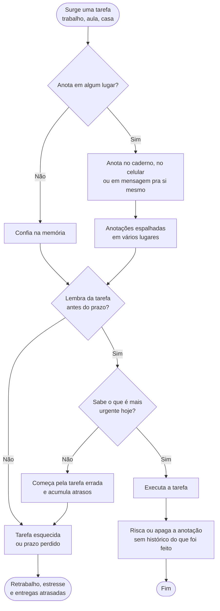
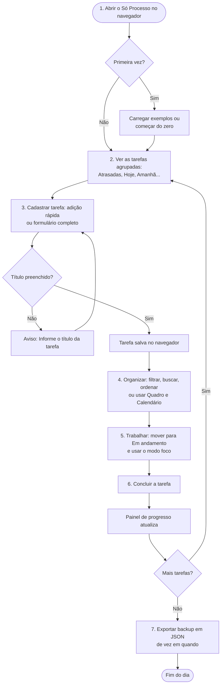

# Pré-projeto UC HUB – Só Processo

**Projeto A3 – Projeto e Engenharia de Software** · Sprint 1 (Pré-projeto e Canvas)

Aplicação web para organização de tarefas do dia a dia.

---

## Questão 1 – Quem são os integrantes do grupo?

| Componente | Nome completo | RA | E-mail | Curso |
|---|---|---|---|---|
| 1 | Pedro Duarte | 4261212023 | _[preencher]_ | _[preencher]_ |
| 2 | Vitor Ramos | 4261216220 | _[preencher]_ | _[preencher]_ |
| 3 | Matheus Brum | 4261215149 | _[preencher]_ | _[preencher]_ |

## Questão 2 – Há parceria?

_(Sem parceria. Deixar em branco na entrega.)_

## Questão 3 – Produtos concorrentes ou similares

| Nome do app concorrente | Link / fabricante | O que ele faz (forças) | O que ele não faz (fraquezas) | O Só Processo contribui (ganha) em | O Só Processo não contempla (perde) em |
|---|---|---|---|---|---|
| **Todoist** | todoist.com · Doist | Lista de tarefas com prazos, prioridades, projetos e etiquetas; entende datas escritas em linguagem natural; sincroniza entre aparelhos | Exige conta e internet para sincronizar; vários recursos (como lembretes e visualizações avançadas) ficam nos planos pagos; não tem modo foco (Pomodoro) | Funciona sem conta, sem instalação e sem internet; modo foco que soma o tempo gasto em cada tarefa; lista, quadro e calendário no mesmo app, tudo grátis | Sincronização entre aparelhos; lembretes e notificações; tarefas recorrentes; colaboração entre pessoas |
| **Microsoft To Do** | to-do.office.com · Microsoft | Listas de tarefas, "Meu dia", prazos, lembretes e etapas (subtarefas); grátis; integrado ao Outlook | Exige conta Microsoft; não tem quadro Kanban nem calendário do mês; não tem modo foco nem painel de progresso | Quadro Kanban com arrastar e soltar; calendário do mês; painel de resumo com % de progresso; modo foco; adição rápida com comandos (`@amanhã !alta #faculdade`) | Lembretes; sincronização na nuvem; integração com e-mail e calendário da Microsoft |
| **Trello** | trello.com · Atlassian | Quadros Kanban com cartões, listas, etiquetas, checklists e prazos; colaboração em equipe | Feito para projetos e equipes, não para a rotina pessoal; exige conta; algumas visualizações (como calendário) ficam nos planos pagos; não agrupa as tarefas por "hoje / atrasadas" | Visões prontas do dia (Hoje, Próximos 7 dias, Atrasadas); lista agrupada por período; prioridade baixa/média/alta; modo foco; uso individual simples, sem configurar quadros | Colaboração em equipe; anexos e comentários; automações e integrações |

## Questão 4 – Quais os envolvidos? Quem vai utilizar a aplicação?

- **Usuário (estudante ou pessoa que organiza a própria rotina):** cadastra, consulta, edita, conclui e exclui as próprias tarefas; organiza por categorias; usa o modo foco; faz backup dos dados.
- **Administrador:** não existe. O app é de uso individual, roda no navegador do próprio usuário e não tem login nem servidor (fora do escopo desta versão).

## Questão 5 – Qual o fluxo da atividade abordada? (processo atual, sem a solução)

Hoje, sem uma ferramenta, a pessoa anota as tarefas em vários lugares (caderno, bloco de notas do celular, mensagens para si mesma) e depende da memória para lembrar dos prazos:

**Problemas do processo atual:** informação espalhada, ninguém avisa o que vence hoje ou já atrasou, prioridades confusas e nenhum acompanhamento do que já foi concluído.

## Questão 6 – Como o produto age sobre o problema? Qual a contribuição?

O Só Processo concentra todas as tarefas em um único lugar e organiza a rotina sozinho:

- **Centraliza:** cada tarefa tem título, descrição, prazo, prioridade, categoria e subtarefas. Dá para cadastrar em uma linha só (`Estudar SQL @amanhã !alta #faculdade`).
- **Mostra o que é urgente:** a lista se agrupa automaticamente em Atrasadas, Hoje, Amanhã, Próximos 7 dias, Mais adiante e Sem prazo, e cada tarefa mostra "Hoje", "Amanhã" ou "Atrasada há N dias".
- **Organiza a execução:** quadro Kanban (A fazer → Em andamento → Concluída) e calendário do mês, onde arrastar a tarefa para outro dia muda o prazo.
- **Ajuda a concentrar:** modo foco (Pomodoro de 15, 25 ou 50 minutos) que soma o tempo gasto em cada tarefa.
- **Acompanha o progresso:** painel com pendentes, em andamento, atrasadas, concluídas e o percentual concluído.
- **Sem barreiras de uso:** abre no navegador, sem instalar, sem criar conta e sem internet; os dados ficam salvos no próprio navegador e podem ser exportados em arquivo de backup.

## Questão 7 – Interfaces (telas) previstas

O app já tem uma versão funcional. As telas principais são:

| Tela | O que mostra | Captura |
|---|---|---|
| **Lista** (tela principal) | Barra lateral com visões (Hoje, Próximos 7 dias, Atrasadas, Todas) e categorias; painel de resumo; campo de adição rápida; busca, filtros e ordenação; tarefas agrupadas por período | `site/img/lista.jpg` |
| **Quadro** | Três colunas (A fazer, Em andamento, Concluída) com arrastar e soltar | `site/img/quadro.jpg` |
| **Calendário** | Mês com as tarefas no dia do prazo; arrastar muda o prazo; dois cliques criam tarefa no dia | `site/img/calendario.jpg` |
| **Janela da tarefa** | Formulário com título, descrição, prazo, prioridade, categoria, status e subtarefas | (ver app) |
| **Modo foco** | Relógio Pomodoro da tarefa escolhida e total de minutos de foco | `site/img/foco.jpg` |
| **Tema escuro e celular** | Mesmo app no tema escuro e em tela pequena | `site/img/escuro.jpg`, `site/img/celular.jpg` |

As capturas estão na pasta `site/img/` do repositório e podem ser coladas no template.

## Questão 8 – Sequência de atividades da solução (como utilizar)

Em qualquer momento o usuário pode **editar** uma tarefa (clicando nela) ou **excluí-la**, com opção de desfazer.
