# Documentação do Projeto – Só Processo

**Projeto Final A3 – Projeto e Engenharia de Software** · Sprint 2 (Projeto Final e Pitch) · entrega 18/11/2026

> Esta documentação segue a lista de artefatos do item 9.2 da especificação da A3. Quando o template oficial do professor for disponibilizado, basta transpor cada seção para ele.

---

## 1. Identificação do projeto

| | |
|---|---|
| **Nome** | Só Processo |
| **Tipo** | Aplicação web (organização de tarefas) |
| **Unidade curricular** | Projeto e Engenharia de Software |
| **Repositório** | https://github.com/Xandxl00/so-processo |
| **Quadro de tarefas** | _[link do GitHub Projects]_ |
| **Aplicação publicada** | _[endereço do site, se publicado]_ |

## 2. Integrantes e responsabilidades

| Integrante | RA | Responsabilidades principais |
|---|---|---|
| Pedro Duarte | 4261212023 | Regras de negócio e armazenamento (`js/tarefas.js`), testes automatizados, modelo de dados |
| Vitor Ramos | 4261216220 | Interface (`index.html`, `css/style.css`, `js/app.js`), protótipos das telas, site de apresentação |
| Matheus Brum | 4261215149 | Requisitos, casos de uso e diagramas, gestão do backlog, documentação e pitch |

> Responsabilidades sugeridas: o grupo deve ajustar conforme a divisão real do trabalho.

## 3. Problema e justificativa

Muitas pessoas, principalmente estudantes que conciliam aulas, trabalho e vida pessoal, têm dificuldade para organizar as atividades diárias. As tarefas ficam anotadas em vários lugares (caderno, celular, mensagens) ou só na memória. O resultado são tarefas esquecidas, prazos perdidos e a sensação de que tudo é urgente, sem saber por onde começar.

A literatura de gestão do tempo associa o planejamento e a priorização das tarefas a mais sensação de controle e menos estresse (MACAN, 1994; CLAESSENS *et al.*, 2007), e a procrastinação é um problema frequente entre estudantes (STEEL, 2007). As ferramentas existentes (Todoist, Microsoft To Do, Trello) resolvem parte do problema, mas exigem conta e internet, deixam recursos importantes nos planos pagos ou são voltadas para equipes, e não para a rotina individual.

**Justificativa:** uma aplicação gratuita, que abre direto no navegador, sem cadastro, e que organiza sozinha o que é urgente, reduz a barreira de entrada e ajuda o usuário a manter o hábito de registrar e concluir suas tarefas.

## 4. Objetivos

**Objetivo geral:** desenvolver uma aplicação web simples que ajude estudantes e pessoas em geral a organizar e acompanhar suas tarefas diárias.

**Objetivos específicos:**
1. Permitir cadastrar, visualizar, editar, excluir e concluir tarefas.
2. Registrar prazo, prioridade e categoria de cada tarefa e destacar as atrasadas.
3. Oferecer visualização em lista agrupada por período, quadro Kanban e calendário.
4. Mostrar indicadores de progresso (pendentes, em andamento, atrasadas, concluídas e %).
5. Apoiar a concentração com um modo foco (Pomodoro) que registre o tempo por tarefa.
6. Garantir a qualidade das regras de negócio com testes automatizados.

## 5. Público-alvo

Estudantes e pessoas que precisam organizar suas atividades diárias, com conhecimentos básicos de uso de computador ou celular. Não é necessário conhecimento técnico, conta ou instalação.

## 6. Escopo

**Ambiente de execução:** navegador moderno (Chrome, Edge ou Firefox), no computador ou no celular. Não precisa de servidor nem de internet: basta abrir o `index.html`.

**Contemplado na versão final:**
- Cadastro completo de tarefas (CRUD), com prazo, prioridade, categoria, status e subtarefas.
- Lista agrupada por período, quadro Kanban, calendário do mês.
- Visões prontas, busca, filtros e ordenações.
- Categorias com cor, painel de resumo, adição rápida com comandos.
- Modo foco (Pomodoro), backup em JSON, tema claro/escuro e fundo personalizado.

**Não contemplado (fora do escopo):**
- Login de usuários e uso por várias pessoas.
- Notificações e lembretes automáticos.
- Sincronização entre aparelhos e integração com outros sistemas (Google Agenda, e-mail).
- Tarefas recorrentes.

**Limitações:**
- Os dados ficam no navegador do aparelho (`localStorage`, cerca de 5 MB). Limpar os dados do navegador apaga as tarefas, por isso existe o backup em arquivo.
- Cada aparelho tem sua própria lista de tarefas.

## 7. Requisitos funcionais

Prioridade: **E** = essencial (escopo inicial), **D** = desejável (evolução).

| Código | Requisito | Prioridade | Casos de uso |
|---|---|---|---|
| RF01 | O sistema deverá permitir cadastrar tarefas, com título obrigatório (até 100 caracteres) e descrição opcional (até 500). | E | UC01, UC02 |
| RF02 | O sistema deverá permitir visualizar as tarefas cadastradas. | E | UC03 |
| RF03 | O sistema deverá permitir editar tarefas. | E | UC04 |
| RF04 | O sistema deverá permitir excluir tarefas, com opção de desfazer. | E | UC05 |
| RF05 | O sistema deverá permitir marcar e desmarcar tarefas como concluídas. | E | UC06 |
| RF06 | O sistema deverá permitir definir uma data de prazo e indicar "Hoje", "Amanhã", o dia da semana ou "Atrasada há N dias". | E | UC01, UC04 |
| RF07 | O sistema deverá permitir definir a prioridade: baixa, média (padrão) ou alta. | E | UC01, UC04 |
| RF08 | O sistema deverá permitir filtrar as tarefas por status: pendentes, em andamento ou concluídas. | E | UC03 |
| RF09 | O sistema deverá controlar três status: A fazer, Em andamento e Concluída. | D | UC07 |
| RF10 | O sistema deverá exibir um quadro Kanban com três colunas, com arrastar e soltar (ou setas no celular). | D | UC07 |
| RF11 | O sistema deverá permitir criar, filtrar e excluir categorias com cor; ao excluir, as tarefas ficam sem categoria. | D | UC09 |
| RF12 | O sistema deverá permitir subtarefas (até 30 por tarefa), mostrando o progresso (ex.: 2/5). | D | UC01, UC10 |
| RF13 | O sistema deverá oferecer as visões Hoje, Próximos 7 dias, Atrasadas e Todas. | D | UC03 |
| RF14 | O sistema deverá permitir buscar por texto no título, descrição e subtarefas, ignorando acentos e maiúsculas. | D | UC03 |
| RF15 | O sistema deverá permitir filtrar por prioridade e ordenar por prazo, prioridade, mais recentes ou ordem alfabética. | D | UC03 |
| RF16 | O sistema deverá exibir um painel com pendentes, em andamento, atrasadas, concluídas e percentual de progresso. | D | UC03 |
| RF17 | O sistema deverá agrupar a lista por período: Atrasadas, Hoje, Amanhã, Próximos 7 dias, Mais adiante, Sem prazo e Concluídas. | D | UC03 |
| RF18 | O sistema deverá permitir a adição rápida em uma linha com comandos (`@hoje`, `@amanhã`, `@dd/mm`, `!alta`, `#categoria`). | D | UC02 |
| RF19 | O sistema deverá permitir exportar e importar as tarefas em arquivo JSON. | D | UC12 |
| RF20 | O sistema deverá permitir escolher tema claro, escuro ou automático. | D | UC13 |
| RF21 | O sistema deverá exibir um calendário do mês em que arrastar a tarefa muda o prazo e dois cliques num dia criam uma tarefa. | D | UC08 |
| RF22 | O sistema deverá oferecer um modo foco (Pomodoro) de 15, 25 ou 50 minutos que some o tempo de foco na tarefa. | D | UC11 |
| RF23 | O sistema deverá permitir personalizar o fundo com degradê, cor sólida ou imagem própria, com controle de intensidade. | D | UC13 |

## 8. Requisitos não funcionais

| Código | Categoria | Requisito |
|---|---|---|
| RNF01 | Usabilidade | Interface em português, com atalhos de teclado (`N` nova tarefa, `/` busca, `Esc` fecha), mensagens de erro claras e opção de desfazer exclusões. |
| RNF02 | Responsividade e compatibilidade | Funcionar no Chrome, Edge e Firefox atuais, no computador e no celular, com layout adaptado a telas pequenas. |
| RNF03 | Armazenamento e backup | Salvar os dados no navegador (`localStorage`), sem servidor; permitir backup em JSON; migrar automaticamente os dados da versão 1. |
| RNF04 | Manutenibilidade | Separar as regras de negócio (`tarefas.js`) da interface (`app.js`) e cobri-las com testes automatizados. |
| RNF05 | Segurança | Nunca inserir texto do usuário como HTML, evitando injeção de código (XSS). Nenhum dado sai do aparelho. |
| RNF06 | Acessibilidade | Botões com rótulos para leitores de tela, foco do teclado visível, e cor nunca como única informação. |
| RNF07 | Desempenho | Abrir e responder às ações de forma imediata (menos de 1 segundo para centenas de tarefas), sem dependências externas para funcionar. |
| RNF08 | Requisitos de hardware e software | Qualquer computador ou celular com navegador moderno. Para rodar os testes: Node.js 18 ou mais novo. |

## 9. Casos de uso

**Ator:** Usuário (estudante ou pessoa que organiza a própria rotina). O armazenamento do navegador (`localStorage`) é usado pelo sistema, mas não é um ator que inicia ações.

### 9.1 Diagrama de casos de uso

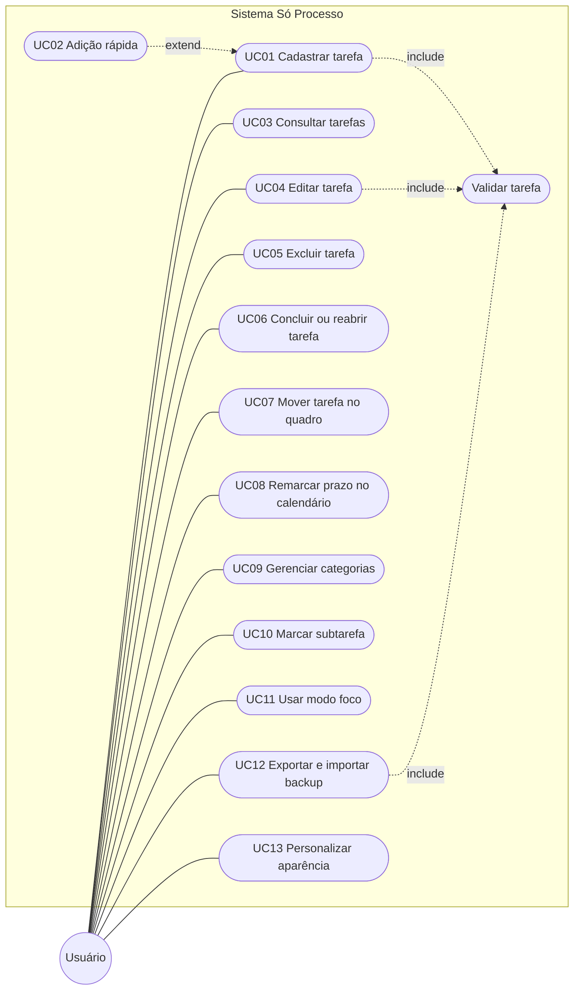

### 9.2 Especificação dos casos de uso

#### UC01 – Cadastrar tarefa
- **Requisitos:** RF01, RF06, RF07, RF11, RF12
- **Pré-condição:** app aberto no navegador.
- **Fluxo principal:**
  1. O usuário clica em "Nova tarefa" (ou aperta `N`).
  2. O sistema abre a janela da tarefa com prioridade "média" e status "a fazer" preenchidos.
  3. O usuário informa título e, se quiser, descrição, prazo, prioridade, categoria, status e subtarefas.
  4. O usuário clica em "Salvar".
  5. O sistema valida os dados, cria a tarefa com identificador e data de criação, e grava no navegador.
  6. O sistema fecha a janela, mostra o aviso "Tarefa criada." e exibe a tarefa no grupo do seu período.
- **Fluxos alternativos:**
  - **A1 – Título vazio (passo 5):** o sistema mostra "Informe o título da tarefa." e mantém a janela aberta.
  - **A2 – Título com mais de 100 caracteres:** o sistema mostra "O título pode ter no máximo 100 caracteres."
  - **A3 – Cancelar:** o usuário fecha a janela (ou aperta `Esc`) e nada é gravado.
  - **A4 – Pelo calendário:** o usuário dá dois cliques em um dia do calendário e a janela abre com o prazo daquele dia.
- **Pós-condição:** tarefa gravada e visível na lista, no quadro e no calendário.

#### UC02 – Adição rápida (estende UC01)
- **Requisitos:** RF18
- **Fluxo principal:**
  1. O usuário digita no campo de adição rápida, por exemplo `Estudar SQL @amanhã !alta #faculdade`, e aperta Enter.
  2. O sistema interpreta os comandos: `@hoje`, `@amanhã` ou `@dd/mm` viram prazo; `!alta`, `!media` ou `!baixa` viram prioridade; `#nome` vira categoria.
  3. O restante do texto vira o título, e a tarefa é criada como no UC01 (passos 5 e 6).
- **Fluxos alternativos:**
  - **A1 – Comando inválido** (data inexistente, como `@31/02`, ou categoria que não existe): a palavra permanece no título.
  - **A2 – Só comandos, sem título:** o sistema mostra "Informe o título da tarefa."

#### UC03 – Consultar tarefas
- **Requisitos:** RF02, RF08, RF13 a RF17
- **Fluxo principal:**
  1. O usuário abre o app.
  2. O sistema carrega as tarefas salvas e mostra a lista agrupada por período, o painel de resumo e os contadores de cada visão.
  3. O usuário escolhe uma visão (Hoje, Próximos 7 dias, Atrasadas, Todas ou uma categoria), filtra por status ou prioridade, busca por texto ou muda a ordenação.
  4. O sistema atualiza a lista na hora. Concluídas vão sempre para o fim.
- **Fluxos alternativos:**
  - **A1 – Trocar modo:** o usuário escolhe Quadro ou Calendário e o sistema mostra as mesmas tarefas filtradas nesse formato.
  - **A2 – Nenhum resultado:** o sistema mostra "Nada encontrado" com o botão "Limpar filtros".
  - **A3 – Primeiro acesso:** sem tarefas, o sistema mostra "Nenhuma tarefa ainda" com os botões "Nova tarefa" e "Carregar exemplos".
- **Pós-condição:** visão, ordenação, modo e tema escolhidos ficam salvos para a próxima vez.

#### UC04 – Editar tarefa
- **Requisitos:** RF03
- **Pré-condição:** existe ao menos uma tarefa.
- **Fluxo principal:**
  1. O usuário clica na tarefa.
  2. O sistema abre a janela com todos os dados preenchidos.
  3. O usuário altera os campos e clica em "Salvar".
  4. O sistema valida, grava e mostra "Alterações salvas."
- **Fluxos alternativos:** A1 a A3 do UC01. Se o status mudar para "concluída", o sistema registra a data de conclusão; se sair de "concluída", a data é apagada.

#### UC05 – Excluir tarefa
- **Requisitos:** RF04
- **Fluxo principal:**
  1. O usuário clica na lixeira da tarefa na lista (ou em "Excluir" na janela da tarefa).
  2. O sistema remove a tarefa e mostra "Tarefa excluída." com o botão "Desfazer".
- **Fluxos alternativos:**
  - **A1 – Desfazer:** o usuário clica em "Desfazer" e o sistema restaura a tarefa como estava.
  - **A2 – Limpar concluídas:** no grupo "Concluídas", o usuário clica em "Limpar concluídas" e o sistema exclui todas de uma vez ("N tarefas excluídas."), também com "Desfazer".
- **Pós-condição:** tarefa removida (ou restaurada).

#### UC06 – Concluir ou reabrir tarefa
- **Requisitos:** RF05, RF16
- **Fluxo principal:**
  1. O usuário marca a caixa de conclusão da tarefa.
  2. O sistema muda o status para "concluída", registra a data de conclusão, move a tarefa para o grupo "Concluídas" e atualiza o painel de progresso.
  3. O sistema mostra "Tarefa concluída." com a opção de desfazer.
- **Fluxos alternativos:**
  - **A1 – Reabrir:** o usuário desmarca a caixa e a tarefa volta para "a fazer".
  - **A2 – Última tarefa da visão:** ao concluir tudo, o sistema comemora com "Tudo concluído por aqui! Mandou bem."

#### UC07 – Mover tarefa no quadro
- **Requisitos:** RF09, RF10
- **Fluxo principal:**
  1. No modo Quadro, o usuário arrasta o cartão para outra coluna (A fazer, Em andamento, Concluída).
  2. O sistema muda o status e grava.
- **Fluxo alternativo:**
  - **A1 – Celular:** o usuário usa as setas do cartão em vez de arrastar.

#### UC08 – Remarcar prazo no calendário
- **Requisitos:** RF21
- **Fluxo principal:**
  1. No modo Calendário, o usuário arrasta a tarefa para outro dia.
  2. O sistema muda só o prazo, grava e mostra "Prazo mudado para …".
- **Fluxo alternativo:**
  - **A1 – Navegar:** o usuário avança ou volta o mês, ou clica em "Hoje" para voltar ao mês atual.

#### UC09 – Gerenciar categorias
- **Requisitos:** RF11
- **Fluxo principal (criar):**
  1. O usuário clica em "Nova categoria", informa o nome e escolhe uma cor.
  2. O sistema valida, cria a categoria e mostra "Categoria "…" criada."
- **Fluxos alternativos:**
  - **A1 – Nome vazio:** "Informe o nome da categoria."
  - **A2 – Nome repetido** (ignorando acento e maiúsculas): "Já existe uma categoria com esse nome."
  - **A3 – Excluir categoria:** o sistema pede confirmação ("As tarefas dela continuam, só ficam sem categoria.") e, se confirmado, remove a categoria e deixa as tarefas sem categoria.

#### UC10 – Marcar subtarefa
- **Requisitos:** RF12
- **Fluxo principal:**
  1. O usuário abre as subtarefas de uma tarefa na lista e marca um item.
  2. O sistema grava e atualiza o progresso (ex.: 3/5).

#### UC11 – Usar modo foco
- **Requisitos:** RF22
- **Fluxo principal:**
  1. O usuário abre o modo foco de uma tarefa.
  2. O usuário escolhe a duração (15, 25 ou 50 minutos) e clica em "Iniciar".
  3. O sistema faz a contagem regressiva.
  4. Ao terminar, o sistema toca um sino, mostra "Foco concluído! Faça uma pausa." e soma os minutos à tarefa.
- **Fluxos alternativos:**
  - **A1 – Pausar ou fechar antes do fim:** os minutos completos já cumpridos são somados à tarefa.
  - **A2 – Concluir pelo modo foco:** o usuário conclui a tarefa ali mesmo ("Tarefa concluída. Bom foco!").

#### UC12 – Exportar e importar backup
- **Requisitos:** RF19
- **Fluxo principal (exportar):**
  1. O usuário clica em "Exportar".
  2. O sistema gera um arquivo JSON com categorias e tarefas, baixa o arquivo e mostra "Backup exportado."
- **Fluxo principal (importar):**
  1. O usuário clica em "Importar" e escolhe o arquivo.
  2. O sistema pede confirmação ("As tarefas e categorias atuais serão substituídas.").
  3. O sistema valida cada categoria e tarefa do arquivo, substitui os dados e mostra "Backup importado."
- **Fluxos alternativos:**
  - **A1 – Arquivo que não é JSON:** "O arquivo não é um backup válido."
  - **A2 – JSON de outro formato:** "O arquivo não é um backup do Só Processo."
  - **A3 – Tarefa inválida no arquivo:** "Tarefa N do arquivo: …" e nada é substituído.

#### UC13 – Personalizar aparência
- **Requisitos:** RF20, RF23
- **Fluxo principal:**
  1. O usuário alterna o tema (claro, escuro, automático) ou abre "Fundo".
  2. No fundo, escolhe um degradê, uma cor ou uma imagem própria e ajusta a intensidade.
  3. O sistema aplica e salva a escolha.
- **Fluxos alternativos:**
  - **A1 – Arquivo que não é imagem:** "Escolha um arquivo de imagem (JPG, PNG, WEBP…)."
  - **A2 – Imagem grande demais:** "Essa imagem não coube no armazenamento do navegador. Tente uma imagem menor."

## 10. Fluxos

### 10.1 Diagrama de atividades – Cadastrar tarefa (UC01 e UC02)

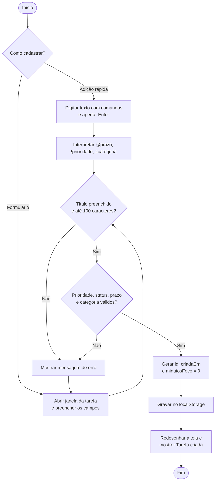

### 10.2 Diagrama de estados – Status da tarefa

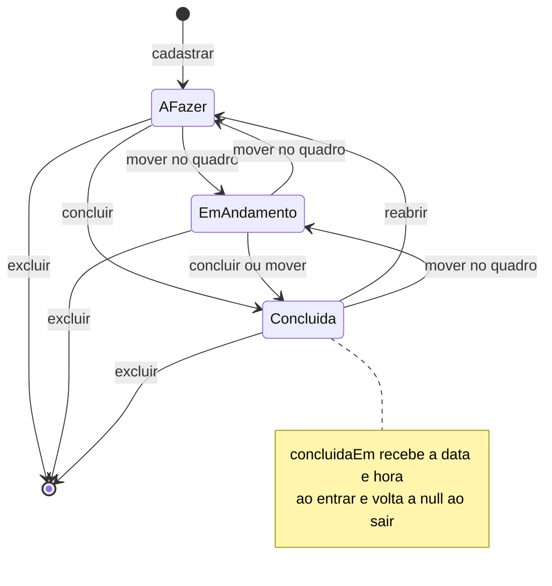

### 10.3 Diagrama de sequência – Concluir tarefa

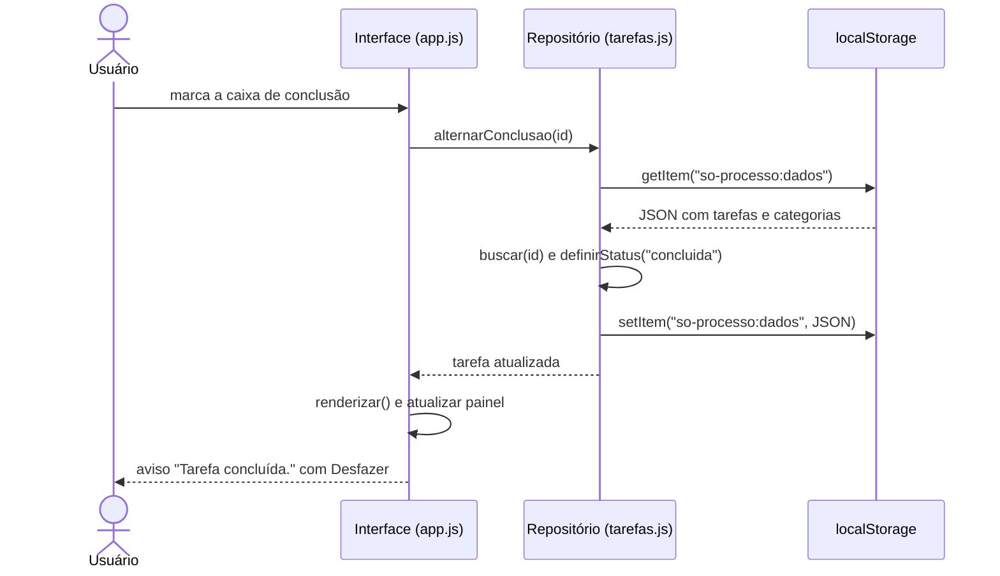

## 11. Diagrama de classes

O código é escrito em JavaScript com funções e objetos (sem a palavra-chave `class`). O diagrama representa as entidades do modelo de dados e os módulos com suas operações, como elas existem no código.

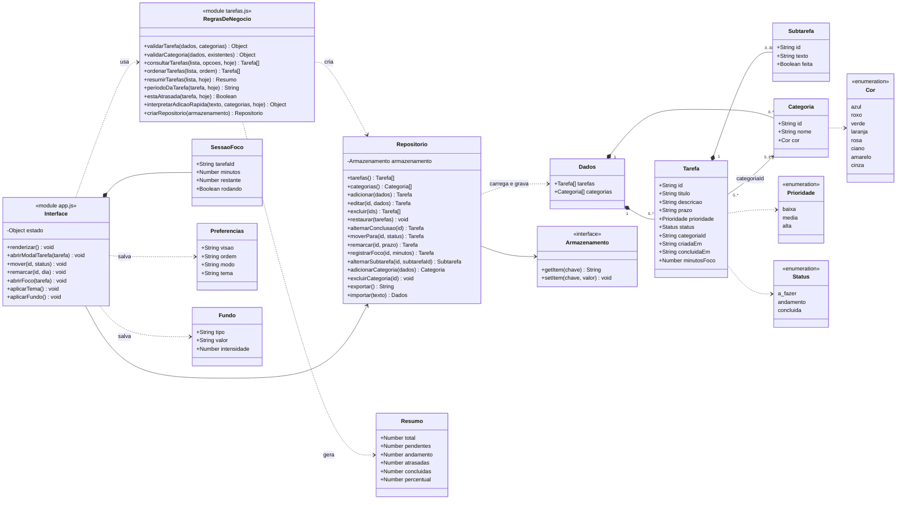

**Decisão de projeto:** o `Repositorio` recebe o `Armazenamento` como parâmetro. No navegador ele recebe o `localStorage`; nos testes, um armazenamento falso em memória. Assim as regras são testadas sem navegador, e trocar o `localStorage` por um banco de dados não exige mudar a interface.

## 12. Modelo de dados

### 12.1 Como os dados são guardados

Os dados ficam no `localStorage` do navegador, em formato JSON, em três chaves:

| Chave | Conteúdo |
|---|---|
| `so-processo:dados` | Tarefas (com suas subtarefas) e categorias |
| `so-processo:preferencias` | Visão, ordenação, modo de exibição e tema escolhidos |
| `so-processo:fundo` | Fundo personalizado (tipo, valor e intensidade) |

Exemplo de `so-processo:dados`:

```json
{
  "categorias": [
    { "id": "faculdade", "nome": "Faculdade", "cor": "azul" }
  ],
  "tarefas": [
    {
      "id": "lz3k9a1b2c",
      "titulo": "Estudar SQL",
      "descricao": "Capítulos 3 e 4",
      "prazo": "2026-10-27",
      "prioridade": "alta",
      "status": "andamento",
      "categoriaId": "faculdade",
      "subtarefas": [
        { "id": "lz3k9a9x1y", "texto": "Ler capítulo 3", "feita": true },
        { "id": "lz3k9b0z2w", "texto": "Fazer exercícios", "feita": false }
      ],
      "criadaEm": "2026-10-25T14:30:00.000Z",
      "concluidaEm": null,
      "minutosFoco": 50
    }
  ]
}
```

### 12.2 Dicionário de dados

**Tarefa**

| Campo | Tipo | Obrigatório | Regra |
|---|---|---|---|
| id | texto | sim | Gerado pelo sistema, único |
| titulo | texto | sim | 1 a 100 caracteres |
| descricao | texto | não | Até 500 caracteres |
| prazo | data (AAAA-MM-DD) | não | Vazio = sem prazo |
| prioridade | texto | sim | `baixa`, `media` (padrão) ou `alta` |
| status | texto | sim | `a_fazer` (padrão), `andamento` ou `concluida` |
| categoriaId | texto | não | Precisa existir em Categoria; vazio = sem categoria |
| subtarefas | lista | não | Até 30 itens; itens sem texto são descartados |
| criadaEm | data e hora (ISO 8601) | sim | Preenchido ao cadastrar |
| concluidaEm | data e hora (ISO 8601) | não | Preenchido ao concluir; `null` nos demais status |
| minutosFoco | número inteiro | sim | Começa em 0; soma das sessões do modo foco |

**Subtarefa:** `id` (texto, gerado), `texto` (texto, obrigatório), `feita` (verdadeiro/falso).

**Categoria:** `id` (texto gerado a partir do nome, único), `nome` (1 a 30 caracteres, sem repetir), `cor` (uma das 8 cores).

### 12.3 DER – Diagrama Entidade-Relacionamento

O app não usa um banco relacional, mas o modelo lógico abaixo representa as mesmas entidades e relacionamentos:

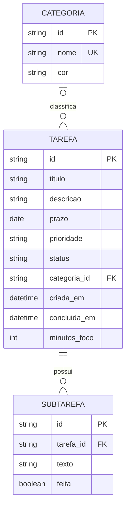

- Uma categoria classifica zero ou muitas tarefas; uma tarefa tem zero ou uma categoria. Ao excluir a categoria, as tarefas ficam sem categoria (`categoria_id` vazio).
- Uma tarefa possui zero a 30 subtarefas; ao excluir a tarefa, as subtarefas vão junto.

### 12.4 Modelo físico equivalente (para uma evolução com banco de dados)

Como o repositório recebe o armazenamento como parâmetro, uma versão futura poderia usar um banco relacional com este script:

```sql
CREATE TABLE categoria (
  id    VARCHAR(40) PRIMARY KEY,
  nome  VARCHAR(30) NOT NULL UNIQUE,
  cor   VARCHAR(10) NOT NULL CHECK (cor IN ('azul','roxo','verde','laranja','rosa','ciano','amarelo','cinza'))
);

CREATE TABLE tarefa (
  id            VARCHAR(20) PRIMARY KEY,
  titulo        VARCHAR(100) NOT NULL,
  descricao     VARCHAR(500) NOT NULL DEFAULT '',
  prazo         DATE,
  prioridade    VARCHAR(5)  NOT NULL DEFAULT 'media' CHECK (prioridade IN ('baixa','media','alta')),
  status        VARCHAR(10) NOT NULL DEFAULT 'a_fazer' CHECK (status IN ('a_fazer','andamento','concluida')),
  categoria_id  VARCHAR(40) REFERENCES categoria(id) ON DELETE SET NULL,
  criada_em     TIMESTAMP NOT NULL,
  concluida_em  TIMESTAMP,
  minutos_foco  INTEGER NOT NULL DEFAULT 0 CHECK (minutos_foco >= 0)
);

CREATE TABLE subtarefa (
  id         VARCHAR(20) PRIMARY KEY,
  tarefa_id  VARCHAR(20) NOT NULL REFERENCES tarefa(id) ON DELETE CASCADE,
  texto      VARCHAR(200) NOT NULL,
  feita      BOOLEAN NOT NULL DEFAULT FALSE
);
```

## 13. Protótipos das telas

As telas abaixo são da versão funcional do app (capturas em `site/img/`).

| Lista | Quadro |
|---|---|
| 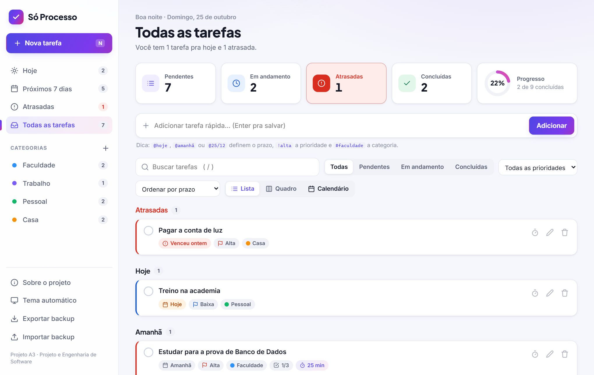 | 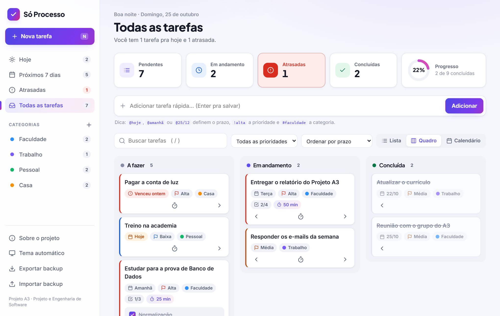 |
| **Calendário** | **Modo foco** |
| 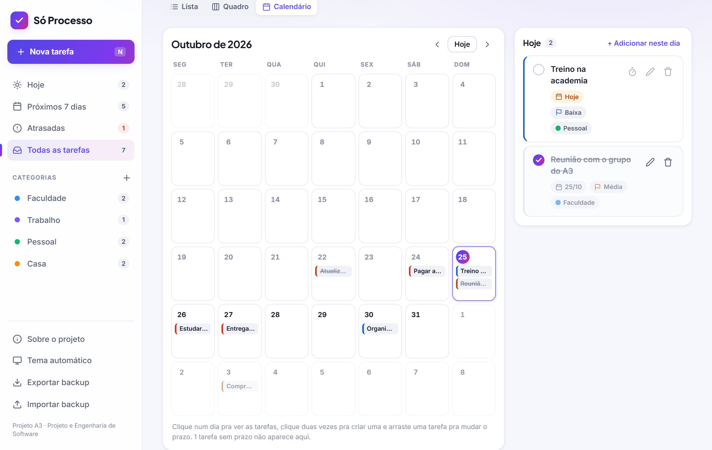 | 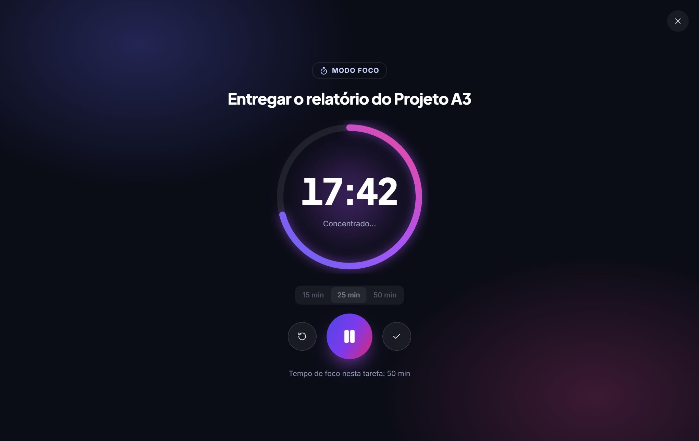 |
| **Tema escuro** | **Celular** |
| 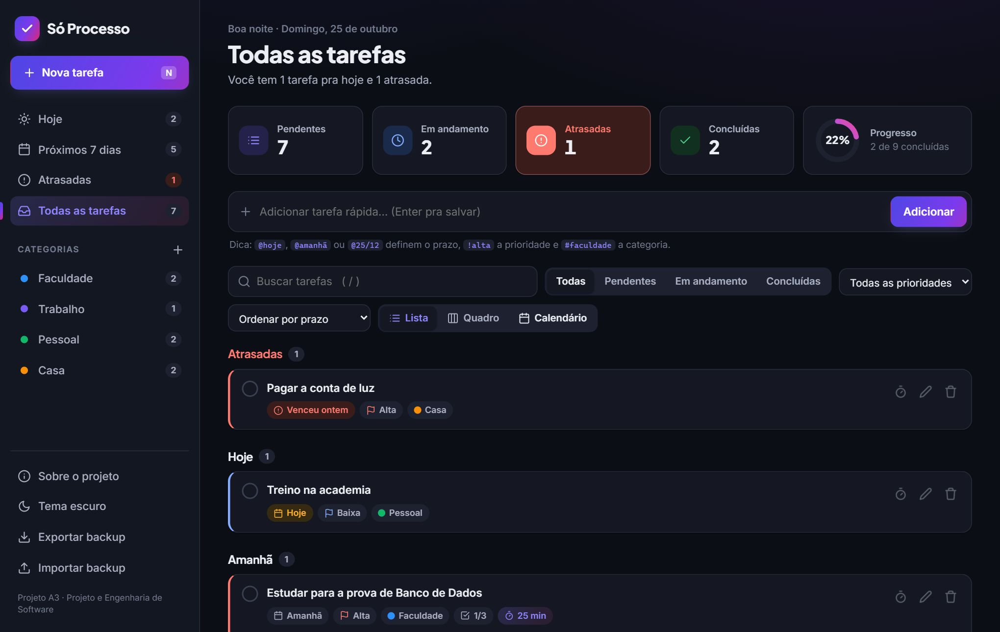 | 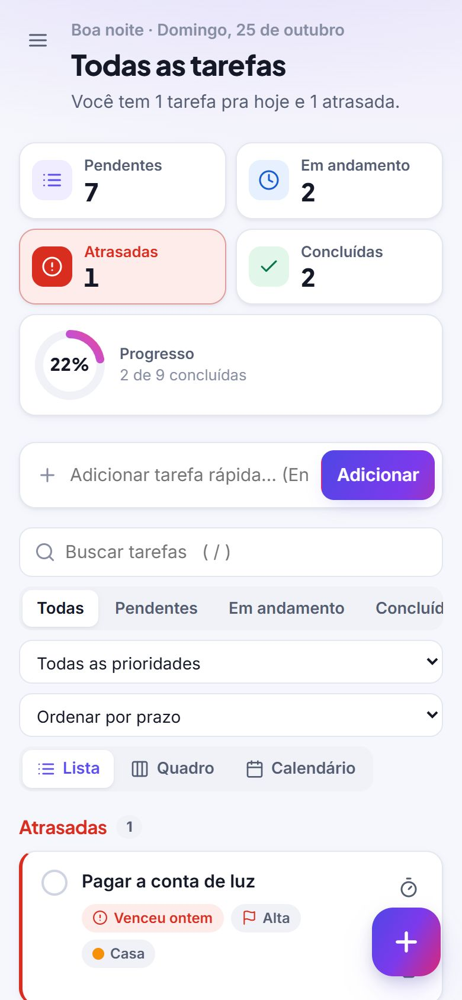 |

## 14. Descrição da solução e arquitetura

O Só Processo é uma aplicação web de página única, organizada em três camadas:

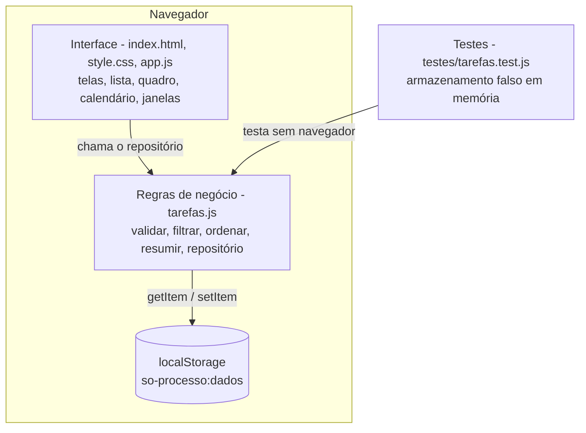

- **Interface (`app.js`):** cada ação do usuário chama o repositório e depois `renderizar()`, que redesenha a tela a partir dos dados salvos. O texto do usuário é sempre inserido como texto, nunca como HTML.
- **Regras de negócio (`tarefas.js`):** validação, filtros, ordenação, resumo, adição rápida e o repositório. Não acessa a tela, por isso roda também no Node.js.
- **Armazenamento:** o repositório carrega os dados, aplica a mudança e grava. Se a mudança der erro (validação), nada é gravado.

## 15. Tecnologias utilizadas

| Tecnologia | Uso |
|---|---|
| HTML5 | Estrutura das telas e janelas (`<dialog>`) |
| CSS3 | Aparência, temas claro/escuro, layout responsivo |
| JavaScript (ES2020+) | Interface e regras de negócio, sem frameworks |
| Web Storage API (`localStorage`) | Persistência dos dados no navegador |
| Drag and Drop API | Arrastar tarefas no quadro e no calendário |
| Node.js 18+ (`node:test`) | Testes automatizados das regras de negócio |
| Git e GitHub | Controle de versões e repositório do código |
| GitHub Projects | Backlog e quadro de acompanhamento das tarefas |
| Mermaid | Diagramas desta documentação |

## 16. Testes

As regras de negócio são verificadas por **38 testes automatizados** (`npm test`), organizados por assunto: requisitos do escopo inicial (RF01 a RF08), status e quadro, subtarefas, categorias, visões/busca/ordenação, adição rápida, armazenamento e backup, calendário, modo foco e datas. Todos passam na versão atual.

## 17. Considerações sobre o desenvolvimento

| Dificuldade | Solução adotada |
|---|---|
| Testar as regras sem abrir o navegador | Separar regras (`tarefas.js`) da interface e injetar o armazenamento no repositório; nos testes usa-se um armazenamento falso em memória |
| A versão 1 guardava as tarefas em outro formato (`concluida: true/false`) | Migração automática para o formato novo (com `status`) na primeira abertura |
| Datas mudando de dia por causa do fuso horário | Datas guardadas como texto `AAAA-MM-DD` no fuso do usuário e diferenças de dias calculadas em UTC |
| Risco de injeção de código pelo texto digitado (XSS) | A interface nunca insere texto do usuário como HTML |
| Imagem de fundo estourando o limite do `localStorage` | Redução automática da imagem e aviso quando ainda assim não couber |
| Perda de dados ao limpar o navegador | Exportar e importar backup em JSON, com validação de cada registro |
| Arrastar e soltar não funciona bem no celular | Setas nos cartões do quadro como alternativa |

## 18. Gestão do projeto

- **Backlog e quadro:** GitHub Projects, colunas Backlog → A fazer → Em desenvolvimento → Em teste → Concluído. Lista de tarefas em [`04-backlog.md`](04-backlog.md). Link: _[preencher]_
- **Repositório:** https://github.com/Xandxl00/so-processo

## 19. Referências

ALLEN, David. **A arte de fazer acontecer**: o método GTD – Getting Things Done. Rio de Janeiro: Sextante, 2016.

ANDERSON, David J. **Kanban**: successful evolutionary change for your technology business. Sequim: Blue Hole Press, 2010.

BELLOTTI, Victoria *et al.* What a to-do: studies of task management towards the design of a personal task list manager. *In*: CONFERENCE ON HUMAN FACTORS IN COMPUTING SYSTEMS (CHI), 2004, Viena. **Proceedings** [...]. New York: ACM, 2004. p. 735-742.

CIRILLO, Francesco. **The Pomodoro Technique**. New York: Currency, 2018.

CLAESSENS, Brigitte J. C. *et al.* A review of the time management literature. **Personnel Review**, v. 36, n. 2, p. 255-276, 2007.

FLANAGAN, David. **JavaScript**: the definitive guide. 7. ed. Sebastopol: O'Reilly Media, 2020.

MACAN, Therese Hoff. Time management: test of a process model. **Journal of Applied Psychology**, v. 79, n. 3, p. 381-391, 1994.

MOZILLA. **Web Storage API**. MDN Web Docs. Disponível em: https://developer.mozilla.org/pt-BR/docs/Web/API/Web_Storage_API. Acesso em: 25 out. 2026.

PRESSMAN, Roger S.; MAXIM, Bruce R. **Engenharia de software**: uma abordagem profissional. 8. ed. Porto Alegre: AMGH, 2016.

SOMMERVILLE, Ian. **Engenharia de software**. 10. ed. São Paulo: Pearson Education do Brasil, 2018.

STEEL, Piers. The nature of procrastination: a meta-analytic and theoretical review of quintessential self-regulatory failure. **Psychological Bulletin**, v. 133, n. 1, p. 65-94, 2007.
